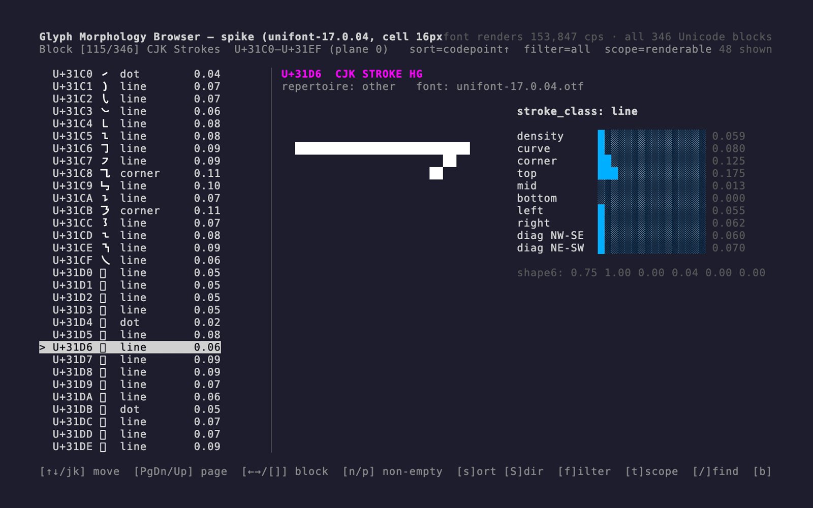
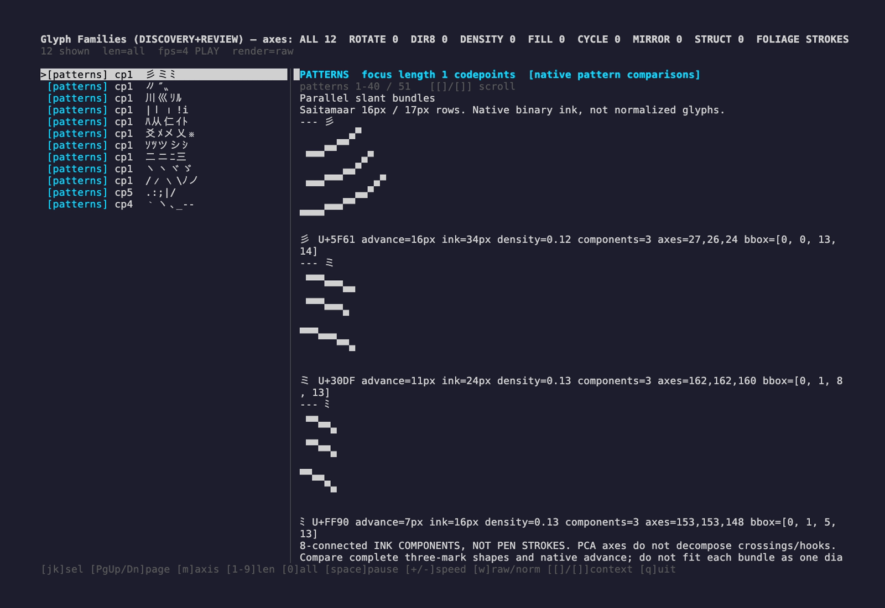
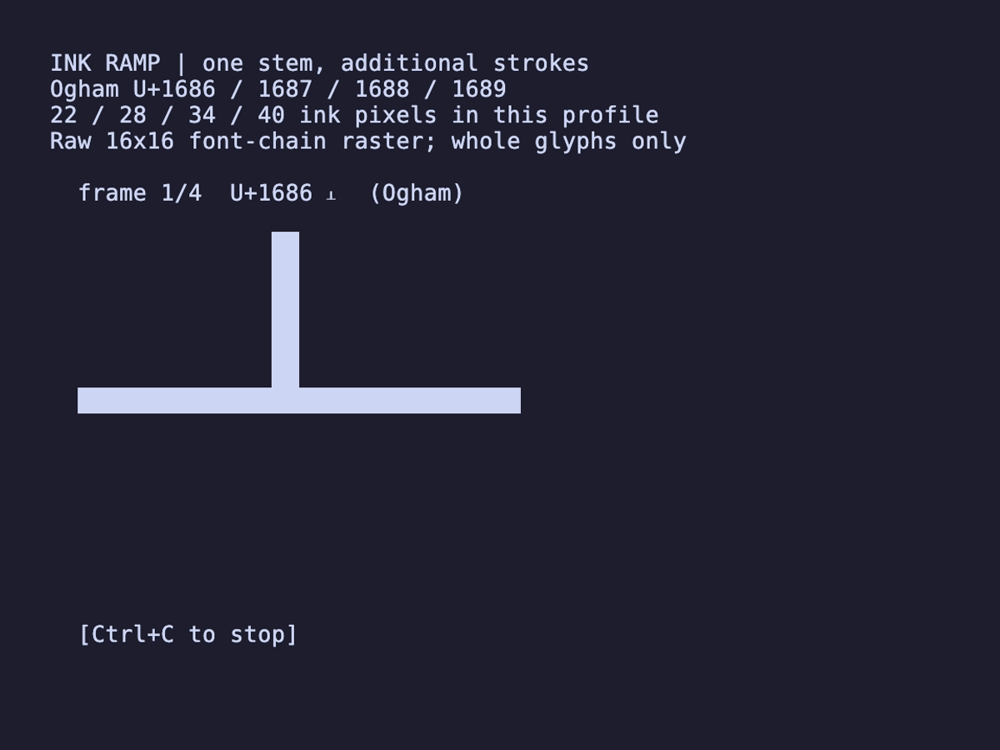

# Unicode Glyph Morphology Explorer

Unicode Glyph Morphology Explorer is a terminal browser for finding Unicode
characters by how they look.

Search for a thin stroke, dense block, diagonal ramp or related shapes without
knowing their Unicode names. The browser renders glyphs through a fixed chain
of eight fonts and compares density, orientation, topology and other shape
features. Individual glyphs use a 16×16 raster. Combination and seam tools
measure positioned terminal cells: 8×16 for narrow glyphs and 16×16 for wide
glyphs.

Browse glyphs, compare their shapes and save useful families for character art
and rendering work.



Single-glyph inspection: turns, curves, parallel stems and hooks in the
browser's 16×16 rendering profile.

## Run

```sh
python3 -m pip install -r requirements.txt
./run-browser.sh --block "CJK Strokes"
```

The interactive browser requires a UTF-8 terminal. List the known Unicode blocks without entering the browser:

```sh
./run-browser.sh --list-blocks
```

Controls are shown in the browser footer. `q` exits without changing tracked files.

## Browse discovered families



Native-pattern comparisons: `彡 / ミ / ﾐ`, `川 / 巛 / ﾘ / ﾙ`, crossed forms,
curved-return combinations and multi-row tone columns. These are the packaged
Saitamaar 16 px rasters at native advances, not stretched terminal glyphs.
Replay this view with `./run-families.sh --mode patterns`.



Ramps and curves: `ᚆ ᚇ ᚈ ᚉ` adds strokes along one stem, `└ / ╰` compares
a sharp and rounded corner, and `レ / し` compares angled and curved returns.
The CLI animator displays complete raw 16×16 font-chain rasters; these selected
comparisons do not stretch glyphs or interpolate between them.

The reproducible recording recipes are
[single-glyph inspection](docs/recordings/glyph-morphology-explorer.tape),
[native-pattern comparisons](docs/recordings/glyph-families-viewer.tape), and
[ramps and curves](docs/recordings/glyph-ramps-and-curves.tape).

The family viewer shows reviewed glyph sequences as animated shape families.
You can switch morphology axes, filter by family length, change speed, pause on
a specific sequence, review distraction ranking, inspect authored multi-cell
seeds beside their mirrors, and browse measured useful-combination candidates
from mined usage, seam pairs, and geometry-discovered Unicode runs.

```sh
./run-families.sh
```

The first run builds local ignored caches under `.run/`: the morphology feature
cache, the discovered-family catalog, the cell-feature cache for the standalone
font-chain repertoire, mined Stone Story tutorial-plate usage, seam-pair
indexes, geometry-discovered run indexes up to length 4, and the measured
combination gallery.
After that, the same command opens the read-only viewer directly. Use `j`/`k`
to select, `m` to change the morphology axis, `1`–`9` to filter by family
length, and `q` to exit.

The direct Python entrypoint uses the same loaded family set. With no arguments
it opens on the `COMBOS` axis first, while `--mode all` starts on the mixed
all-family list:

```sh
python3 scripts/glyph_families_viewer.py
python3 scripts/glyph_families_viewer.py --mode all
```

## Current family registry

The tracked review registry contains 96 nonblank family records. Fifteen records
come from the current Y9-2 source artifact: twelve `cycle` records covering
Latin-1 Supplement, Arabic, Basic Latin, Latin Extended-B, Greek Extended,
Mathematical Operators, and Cherokee, plus three `stroke` records covering CJK
Strokes and Katakana.

The `cycle` records use the viewer's existing family vocabulary. The three
`stroke` records are also visible through the viewer's stroke review surface.
The full registry is in
[docs/research/ascii/glyph_audit/saved_families.jsonl](docs/research/ascii/glyph_audit/saved_families.jsonl),
with source boundaries documented in [docs/code-provenance.md](docs/code-provenance.md).

## Glyph combinations

The package includes the authored Stone Story combination seed dictionary at
`assets/glyphs/authored/glyph_combinations.v1.json`. The viewer can render those
seeds with:

```sh
python3 scripts/glyph_families_viewer.py --mode combo --dump
```

That `combo` mode is the full useful-combination browser. For just the nine
authored seed rows:

```sh
python3 scripts/glyph_families_viewer.py --mode authored --dump
```

For broader review, `scripts/glyph_combo_candidates.py` enumerates every
connected two- and three-cell arrangement over the full Stone Story plate
line-art alphabet: 25 basic marks plus 4 extended marks. It reports 148,016
candidates before any manual art selection:

```sh
python3 scripts/glyph_combo_candidates.py --limit 20
```

`scripts/glyph_combo_mine.py` counts recurring combinations in the packaged
Stone Story tutorial plates. `scripts/glyph_seam_index.py` finds measured
adjacent-cell pairs across the standalone font-chain repertoire.
`scripts/glyph_run_walker.py` then walks those seam relations into
variable-length beside and stacked runs. The one-command defaults build length-4
Unicode/Kana/CJK/Arabic review buckets, so examples such as `_.-´`,
`` `-._ ``, `\|/`, `(‾)`, `/‾\`, `\_/`, `|` over `|`, CJK stroke chains, and
Arabic joining-form runs can be reviewed as run families rather than fixed two-
or three-cell tuples.

The viewer helps explore combinations. It does not measure their use in the
Asciicker renderer. That renderer's `combo_hits` counter records candidate
transitions rather than selected or displayed combinations.

The measurement profile matters. These standalone combo and seam artifacts are
8×16 half-width / 16×16 full-width exploration data from the pinned font chain.
Current Asciicker Godot native-terminal work uses a tall 16×32 half-width cell;
full-width glyphs retain intact 32×32 masks across two adjacent tall cells.
Before a family, seam threshold, D_SM radius, altitude rule, or run offset is
used by that renderer, it must be rebased in cell units for the Godot profile.
Orthographic and perspective renderers also need separate testing. A useful
family in this viewer may behave differently in either renderer.

The one-command family viewer builds and opens the measured combination surface
too. To jump straight to it:

```sh
./run-families.sh --mode combo
```

A committed snapshot of the generated HTML review sheet is available at
[docs/artifacts/glyph_combo_gallery.html](docs/artifacts/glyph_combo_gallery.html).
Regenerate the working copy with `python3 scripts/glyph_combo_gallery.py`.

### Shift_JIS AA combinations from the AAHub corpus

`./run-families.sh --mode sjis` opens combinations counted over the AAHub
training slugs (23,363 pages) and drawn in Saitamaar 16 px at their true pixel
offsets, each beside its mirror. The categories are:

- recurring stroke arrangements;
- touching stroke pairs and triples;
- vertical stacks whose centres lie within 3 px;
- tone bands.

`--mode combo` includes them too. The data file is tracked, so no build step
runs. Regenerating it requires the separate source dataset and font:

```sh
python3 scripts/sjis_corpus_combos.py ARCHIVE SPLIT.json Saitamaar-Regular.ttf \
    --out assets/glyphs/corpus/aahub_aa003_train.sjis_combos.v1.json
```

### Browse combinations in source context

The standalone viewer also has a curated source-context axis. It keeps exact
multi-row source passages, paired-artifact provenance, annotation scope, and
interpretation limits beside the combination vocabulary:

```sh
python3 scripts/glyph_families_viewer.py --mode context --dump
./run-families.sh --mode context
```

`--mode combo` includes these context records alongside authored seeds,
measured candidates, and the selected AAHub corpus. Use `[` / `]` in the
interactive viewer to scroll a selected context record; `--dump` prints all
source rows and provenance without opening a TTY.

The terminal pane is **textual context, not a native Saitamaar rendering**:
terminal column widths do not preserve its proportional advances. Use the
record's paired native PNG together with these exact rows before judging glyph
fit, joins or negative shapes. The separately packaged round references below
also offer a native-PNG pixel viewport. Older text-only candidates remain text-only.

The records show glyphs in particular drawings rather than assigning universal
meanings to them. T#7 separates branch marks, falling marks and ground marks.
S#424 contains a whole statue drawing without annotated region rectangles.
C#126 and C#99 retain their source rows and reconstruction details. C#135 has
text only because no matching native PNG was found. The repeated `人_` record
also has text only, with no assigned subject meaning.

The hand examples include open spaces and ordered turntable frames. Interior
fold and joint comparisons are visual analogies, not a mathematical
classification of contours or ridges. These are still frames, not recordings
of the original drawing. `focus length` counts codepoints in a quoted fragment,
not pixels or the full drawing's width. Historical renderer limits and corpus
frequency counts do not describe a glyph's meaning or current renderer behavior.

### Saved Windows AA patterns and tracing source

The saved tools were **AA Judgment, ASCII Justice and Orinrin Editor**. Their
patterns can be inspected on macOS without executing a Windows program:

```sh
python3 scripts/windows_aa_intake.py
./run-families.sh --mode context
./run-families.sh --mode aaj
```

**AA JUDGMENT** (`--mode aaj`) has **40 individually selectable combinations**,
in the recovered builder's order. Each entry shows the intact combination,
codepoints, native proportional placements, a packaged **Saitamaar 16px raster**,
and executable/string addresses. These are labelled comparison rasters—not
recovered Windows/MS Gothic output. No external font or private cache is needed
to browse. `j/k` selects templates; `[/]` scrolls details. All 40 are in COMBOS
and the default browser's AA JUDGMENT axis too.

CONTEXT EVIDENCE and COMBOS include `aa-judgment-composite-matching-templates`
(all **40** recovered sequences), `orinrin-brush-presets` and
`orinrin-multiline-insertions`. These are editor/converter evidence, **not a claim
that these presets produced the supplied AAHub drawings**. Text display is not
native-font rendering.

- [Recovered AA Judgment mappings, addresses and file hashes](assets/glyphs/contextual/windows_aa_patterns.v1.json).
- [All 40 individually rendered template records](assets/glyphs/contextual/aaj_templates.native.v1.json).
- Orinrin's exact [brush groups](assets/glyphs/contextual/windows-aa/aabrush.txt),
  [insertion palette](assets/glyphs/contextual/windows-aa/aalist.txt) and
  [multiline items](assets/glyphs/contextual/windows-aa/UserItem.ast).
  All **24 named palette groups** are now separate CONTEXT EVIDENCE / COMBOS
  records (`orinrin-palette-01` through `orinrin-palette-24`). They preserve
  multi-character entries and the original adjacent-row samples—not just
  individual glyphs. The insertion parser handles nonempty lines separately;
  a pictured multi-row sample is not thereby a one-click macro.
- Retrieved, commit-pinned [tracing source](assets/glyphs/contextual/windows-aa/upstream/TraceCtrl.cpp),
  [template parser](assets/glyphs/contextual/windows-aa/upstream/LineTemplate.cpp),
  [brush selector](assets/glyphs/contextual/windows-aa/upstream/BrushTemplate.cpp) and
  [pixel-width spacing routines](assets/glyphs/contextual/windows-aa/upstream/DocAdjustant.cpp).
  [Source manifest and license](assets/glyphs/contextual/windows_aa_source.v1.json).
- [Findings: circular construction versus automatic tracing](docs/code-provenance.md#circular-construction-synthesis-and-saved-windows-tools-2026-10-24).
- **ASCII Justice recovered:** [919-line HSP2 decompilation](assets/glyphs/contextual/windows-aa/ascii-justice/start.as),
  [93 original 8×16 mask mappings and recovery provenance](assets/glyphs/contextual/ascii_justice_recovery.v1.json),
  [portable edge/matching kernels](scripts/ascii_justice_kernels.py).
  Two clamp lines are malformed in the decompiler output. The portable code
  does not reproduce the complete Windows program's output.
- **Orinrin spacing:** [portable plain/Unicode gap routines](scripts/orinrin_spacing.py),
  transcribed from the retrieved source under its GPL-3.0-or-later terms.
  Their widths are editor assumptions, not measurements of your current font.

AA Judgment matches native-font bitmaps of short strings to image patches.
Orinrin's trace code adjusts and displays an image underlay; the artist still
chooses the glyph construction. Neither is an established circle-construction
algorithm for the archived art. No Windows binary was run or added here.
The recovery findings and exact limits are in
[the algorithm notes](docs/code-provenance.md#aa-judgment-browser-completeness-and-further-algorithm-recovery-2026-10-24).

#### Watch the recovered material

- [AA Judgment pattern browser recording](assets/glyphs/contextual/windows-aa/recordings/luna-aaj-viewer.gif).

The recording shows the pattern browser. It does not show the complete Windows
converter running. The Orinrin palette groups and recovered source are linked
above.
[Recording hashes/provenance](assets/glyphs/contextual/windows-aa/recordings/recordings.v1.json);
[browser-capture retention utility](scripts/aa_recovery_recordings.py).

The exact [919-line listing](assets/glyphs/contextual/windows-aa/ascii-justice/start.as)
is available separately for inspection; the GIF is not presented as a recording
of that original application running.

### Dots and strokes following a surface

The [cup and plate drawing](assets/glyphs/contextual/aramaki-cup-plate-176.txt)
comes from entry `aa[176]` in the AAHub 荒巻スカルチノフ archive.
Sparse dots and directional strokes follow its surfaces. Compare the rim,
the `. / : / ;` field, `彡` side marks and `彳`/`ジ` lower returns.

It is available in `--mode context` and `COMBOS`. The exact variant is currently
text only. A similar image contains rice in place of the reclining character,
so it is not used as a matching PNG.

### Curve construction examples

```sh
./run-families.sh --mode round
./run-families.sh --mode round --dump
```

The CONSTRUCTION CROPS axis (`round`) contains eight screenshots of curve
constructions. They are also available in CONTEXT EVIDENCE and COMBOS.

**Original AAHub sources, including the complete cup drawing:** see the
[consolidated original-reference index](docs/code-provenance.md#original-aahub-reference-index--operators-eight-crops-and-cup-2026-10-24)
and [machine-readable source registry](assets/glyphs/contextual/operator_reference_sources.v1.json).
The index links each crop to its matching full drawing and original AAHub page.
Crop 04's motif appears in variants 105, 106 and 107. All three originals are
included because the crop does not identify a unique variant.

| Crop | Evidence | Exact source binding |
|---|---|---|
| [01](assets/glyphs/contextual/operator-constructions/crop-01.png) | `ｧ宀v` cap, `弋__人` return and `∧` | [Godless Shrine, entry 161, rows 11–13](assets/glyphs/contextual/operator-constructions/church-161.txt) |
| [02](assets/glyphs/contextual/operator-constructions/crop-02.png) | `jI斗-─--ミ` column-cap arc | [Karnak, archived entry 165, rows 7–10](assets/glyphs/contextual/operator-constructions/church-165.txt) |
| [03](assets/glyphs/contextual/operator-constructions/crop-03.png) | `γ⌒ヽ` cap and `乂__ノ` lower return | [Assisi, entry 36, rows 7–8](assets/glyphs/contextual/operator-constructions/church-036.txt) |
| [04](assets/glyphs/contextual/operator-constructions/crop-04.png) | `（(⌒Y⌒)）` paired lobes and `)Ｉi(` | Shared motif in [105](assets/glyphs/contextual/operator-constructions/church-105.txt), [106](assets/glyphs/contextual/operator-constructions/church-106.txt), [107](assets/glyphs/contextual/operator-constructions/church-107.txt), rows 6–7; unique variant unresolved |
| [05](assets/glyphs/contextual/operator-constructions/crop-05.png) | `(　)`, `/⌒Ｙ`, `乂__ﾉ`, `しく__` | [Entry 97, rows 4–7](assets/glyphs/contextual/operator-constructions/church-097.txt) |
| [06](assets/glyphs/contextual/operator-constructions/crop-06.png) | `ｲﾆア゜`, `/ﾆｱ`, `寸ム`, `寸ﾊ`, `Ⅵｉ` changing around an arch band | [Church basement, entry 73, rows 7–17](assets/glyphs/contextual/operator-constructions/church-073.txt) |
| [07](assets/glyphs/contextual/operator-constructions/crop-07.png) | `(__)` over `γ⌒ヽ` / `乂__ソ` | [Kraków St Mary's, entry 57, rows 12–14](assets/glyphs/contextual/operator-constructions/church-057.txt) |
| [08](assets/glyphs/contextual/operator-constructions/crop-08.png) | `γ⌒ヽ` / `{　　　}` / `乂__乂`, with lower neighboring round | [Same entry 57, rows 9–14](assets/glyphs/contextual/operator-constructions/church-057.txt) |

The kanji in crop 06's `寸ム` and `寸ﾊ` is 寸, as recorded in the source text.
The [Milan church passage](assets/glyphs/contextual/operator-constructions/church-027.txt)
is included as another reference. It is not the source of these eight crops.

Use `j`/`k` to select. The initial **overview** uses explicitly labelled integer
ink pooling so the whole reference fits; it is not native glyph-fit evidence.
Press **`v`** for **unscaled screenshot pixels**, **`h`/`l`** to pan horizontally,
and **`[`/`]`** to scroll vertically through the image, exact source rows and
provenance. Screenshot bytes are unchanged; their font pixel size and advance
metrics are not inferred. Both raw archived text and HTML-decoded display text
are packaged for ten source pieces, with separate hashes. No private font,
archive or temporary screenshot path is needed to view the packaged evidence.

For **all eight crops**, the detail pane also shows **CONSTRUCTION / TOOL
COMPARISON**: 32 exact source fragments, their row/codepoint locations,
Saitamaar 16px proportional positions, and exact overlaps with the saved
Orinrin palette/brushes and all 40 AAJ combinations. Six cup fragments have the
same comparison under its `CONTEXT EVIDENCE` entry. Fullwidth/halfwidth forms
and whitespace are not normalized. Partial matches are labelled **PARTIAL**,
not presented as matching whole constructions or evidence of a particular
artist's tool. Saitamaar positions are comparisons, not inferred screenshot
metrics. No synthetic diagnostic pictures or Windows-output claim is involved.

The portable [mapping snapshot](assets/glyphs/contextual/construction_tool_mapping.v1.json)
retains every overlap locator, including repeated punctuation matches grouped
in the pane. Rebuild explicitly with `python3 scripts/construction_tool_mapping.py --write`
using the pinned local font. Browsing needs no font installation. These
comparisons do not reconstruct an automatic image converter.

For the actual mechanism explanation—font-specific construction, dot shifts,
implied continuations, patterned tone, reusable editor fragments, and automatic
local ink fitting—see [what produces the recurring combinations](docs/code-provenance.md#what-produces-the-recurring-combinations--mechanism-answer-2026-10-24).
The forty AAJ composites are **not** its complete output vocabulary; absence of
a whole-circle preset does not establish that sequential matching cannot build
one. The cited practitioner walkthrough uses **（´д｀）Edit**, not Orinrin.

The definition and index are
`assets/glyphs/contextual/operator_construction_crops.sources.v1.json` and
`operator_construction_crops.v1.json`. Explicit packaging from the original
screenshots/archive uses:

```sh
python3 scripts/operator_construction_crops.py --write
```

### Native stroke-bundle and combination comparisons

The supplied Saitamaar comparisons are now a dedicated **NATIVE PATTERNS** axis
and are included in `COMBOS`. Open it directly without rebuilding the full
morphology cache:

```sh
python3 scripts/glyph_families_viewer.py --mode patterns
python3 scripts/glyph_families_viewer.py --mode patterns --dump
./run-families.sh --mode patterns
```

Twelve groups compare parallel/dotted/crossed bundles, narrow and fullwidth
stems, horizontal bands, slope variants, and the quoted tone-band/curved-return
combinations. Use `j`/`k` to select and `[`/`]` to scroll through complete
thresholded Saitamaar rasters, advances, ink coverage, bounding boxes and
component axes. Rasters retain native advances at 16 px with 17 px row pitch;
they are not redrawn with the terminal's font or normalized to square cells.
Widen the terminal when a raster is marked clipped.

The original temporary `bundles.py` and `glyphcheck2.py` were inspected; the
47 supplied bundle-table rows reproduce, including duplicate observations.
**Their "strokes" are 8-connected ink components, not pen strokes.** A component's
PCA axis can conceal a crossing or hook; match the full glyph construction, not
the component count or angle alone. Multi-row tone/curve layouts are comparison
proposals, not approved source passages, renderer fixes or lighting rules.

The input, raw reported stdout, script/font hashes and limits are retained in
`assets/glyphs/contextual/saitamaar_pattern_intake.v1.json`. Its generated,
self-contained raster/measurement snapshot is
`assets/glyphs/contextual/saitamaar_pattern_evidence.v1.json`. Viewing needs no
private font or temporary scripts. Explicit regeneration needs the hash-pinned font:

```sh
python3 scripts/saitamaar_pattern_intake.py --font /path/to/Saitamaar.ttf --write
```

## Included data

The repository includes the morphology browser, the read-only family viewer, the
selected saved-family registry, glyph-combination and contextual-source review
data, the candidate enumerator, a committed combination-gallery snapshot, and
the pinned font chain used for rendering. It does not include the full Asciicker
engine or runtime.

Font identities, copyright metadata, license mapping, and license texts are recorded in [docs/font-provenance.md](docs/font-provenance.md) and `docs/licenses/`. Source-code identities are recorded in [docs/code-provenance.md](docs/code-provenance.md).
